<div align="center">


# MediBuddy

**Your daily medication companion.**<br/>
Track medications, watch your stock, get AI-powered insights, and restock with NETS QR, all in one app.


-E4002B)

<br/>

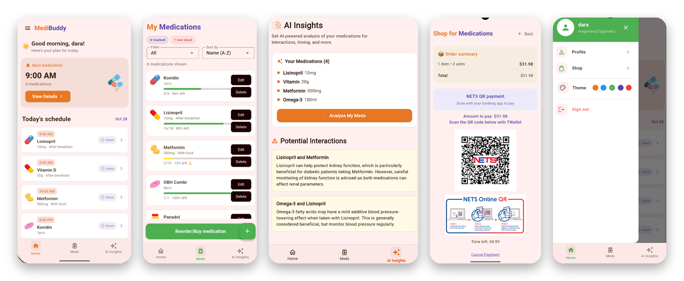

</div>

## Contents

- [Overview](#overview)
- [Features at a glance](#features-at-a-glance)
- [Authentication](#authentication)
- [Home, navigation and profile](#home-navigation-and-profile)
- [Medication management (CRUD)](#medication-management-crud)
- [Advanced Firestore queries](#advanced-firestore-queries)
- [AI Insights](#ai-insights)
- [Shop, cart and NETS QR checkout](#shop-cart-and-nets-qr-checkout)
- [Personalisation](#personalisation)
- [Form validation and feedback](#form-validation-and-feedback)
- [Architecture](#architecture)
- [Getting started](#getting-started)
- [Notes and limitations](#notes-and-limitations)
- [Author](#author)

## Overview

MediBuddy helps people stay on top of their daily medication. You can schedule each medication, see what is due next, keep an eye on how much stock is left, ask an AI assistant about possible interactions, and reorder running-low medication through a built-in shop that pays with **NETS QR**. Buying a medication automatically restocks it (or adds it to your list if it is new).

It is a **Flutter + Firebase** app built for the MBAP module's Project (Part 3) at Temasek Polytechnic, School of Informatics & IT. State management is done end to end with **Riverpod**.

> [!NOTE]
> MediBuddy is a student project. The AI Insights feature gives general information only and is **not medical advice**. Payments use the NETS **sandbox**, so no real money is ever moved.

## Features at a glance

| Area | What it does |
|---|---|
| **Authentication** | Email/password sign up, login, logout, password reset, Google and GitHub sign-in, edit account (name, password, email verification) |
| **Medication CRUD** | Add, view, edit and delete medications in Cloud Firestore with real-time updates |
| **Advanced queries** | Server-side filter and sort, a same-field range filter (Critical Stock), and Firestore `count()` aggregation for live stats |
| **Applied AI** | Groq-powered interaction warnings and plain-English "what each medication does", with smart caching |
| **Shop and cart** | Add to cart or buy now, a Firestore-persisted cart, pack-size aware quantities |
| **NETS QR payment** | Dynamic-amount QR, live countdown, scan detection over SSE, success/fail flow, automatic stock update |
| **Personalisation** | Theme colour picker (saved on device), custom app icon, native splash screen |
| **Validation and feedback** | Inline field errors, SnackBars and confirmation dialogs across the app |

## Authentication

<div align="center">
<table>
  <tr>
    <td align="center" valign="top">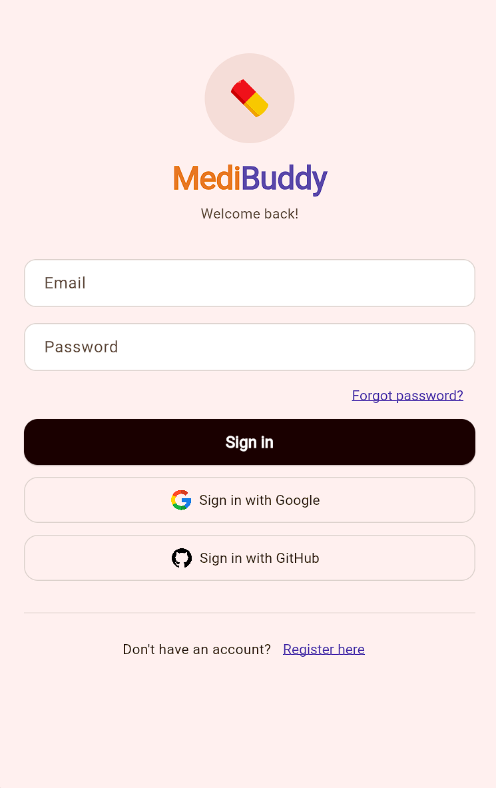<br/><sub><b>Login</b></sub></td>
    <td align="center" valign="top">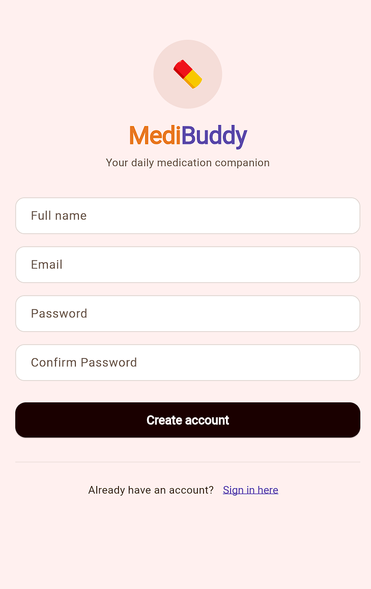<br/><sub><b>Register</b></sub></td>
    <td align="center" valign="top">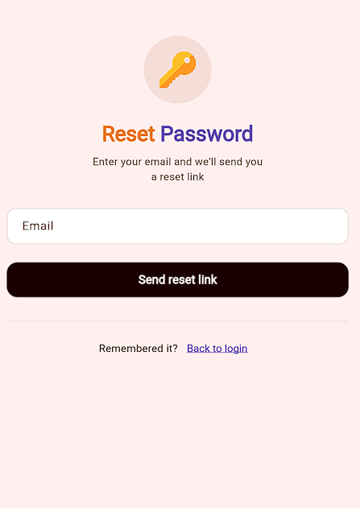<br/><sub><b>Reset password</b></sub></td>
  </tr>
</table>
</div>

- Email and password **sign up, login, logout and password reset** through Firebase Authentication.
- **Google Sign-In** and **GitHub Sign-In** as alternative ways in.
- **Edit account details**: update your display name, change your password and send a verification email.
- Firebase error codes are mapped to friendly messages (wrong password, no account for that email, too many attempts and so on).
- `MediBuddyApp` watches `authStateProvider`: signed-in users land on the main screen and everyone else sees the login screen, so there is no manual navigation after login or logout.

## Home, navigation and profile

<div align="center">
<table>
  <tr>
    <td align="center" valign="top">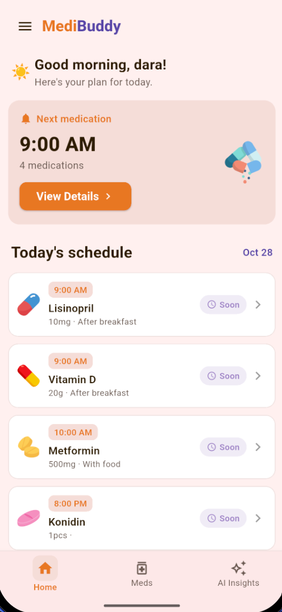<br/><sub><b>Home</b></sub></td>
    <td align="center" valign="top">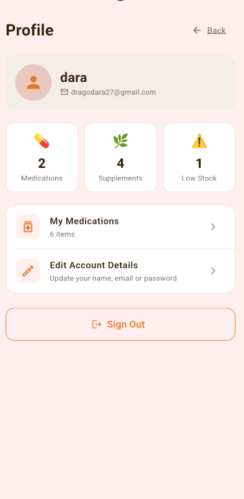<br/><sub><b>Profile</b></sub></td>
    <td align="center" valign="top">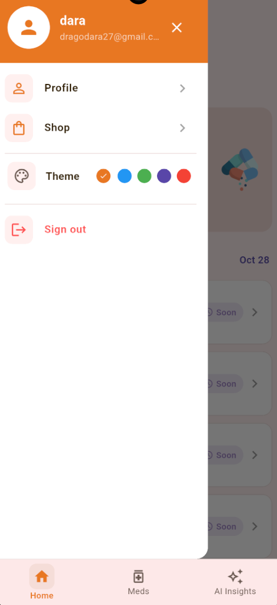<br/><sub><b>Drawer</b></sub></td>
  </tr>
</table>
</div>

- **Next medication** card shows the earliest upcoming scheduled time, calculated from your real Firestore data.
- **Today's schedule** lists every medication with its time, dose and instructions.
- A **refill banner** counts low-stock medications and jumps straight to the Meds tab.
- Three-tab bottom navigation (**Home, Meds, AI Insights**). Profile, Shop, the theme picker and Sign out live in the drawer.
- The **profile** screen summarises your medications, supplements and low-stock count, with a shortcut to edit your account.

## Medication management (CRUD)

<div align="center">
<table>
  <tr>
    <td align="center" valign="top">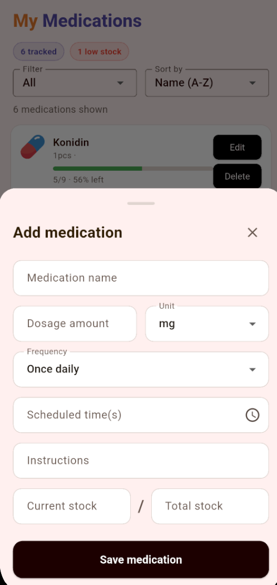<br/><sub><b>Create</b></sub></td>
    <td align="center" valign="top">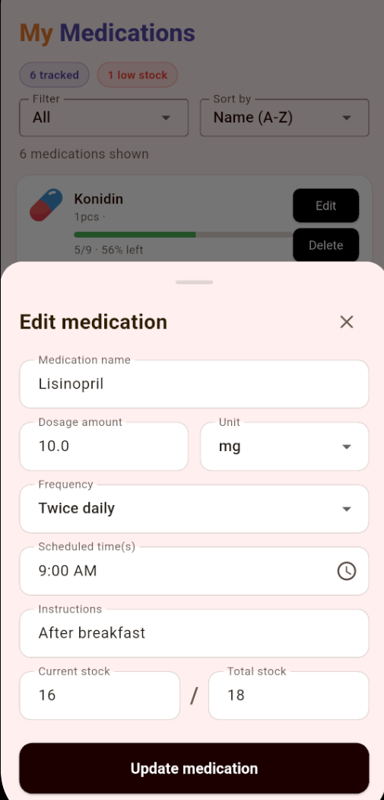<br/><sub><b>Update</b></sub></td>
    <td align="center" valign="top">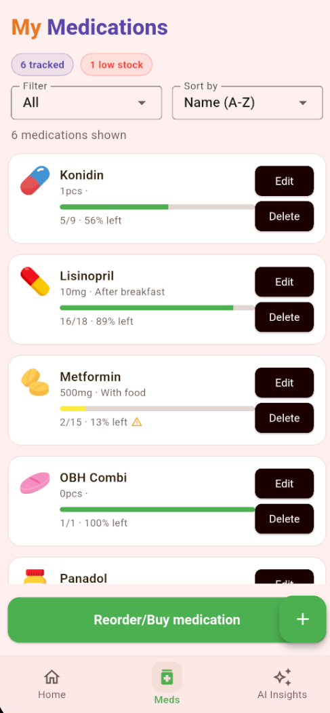<br/><sub><b>Read</b></sub></td>
    <td align="center" valign="top">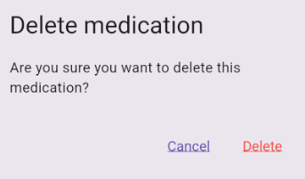<br/><sub><b>Delete</b></sub></td>
  </tr>
</table>
</div>

- **Create and update** share one bottom sheet (`AddMedicationSheet`). It is pre-filled when editing and captures name, dosage and unit, frequency, scheduled time, instructions, and current / total stock.
- **Read** uses a live Firestore stream (`medicationsProvider`), so every screen updates the moment data changes. No manual refresh anywhere.
- **Delete** always asks for confirmation first.
- Each card shows a stock progress bar, "16/18 · 89% left", and a warning icon when stock falls below 25%.

## Advanced Firestore queries

<div align="center">
<table>
  <tr>
    <td align="center" valign="top"><br/><sub><b>All, sorted A-Z</b></sub></td>
    <td align="center" valign="top">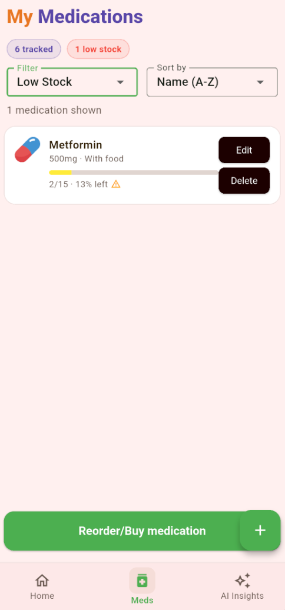<br/><sub><b>Filter: Low Stock</b></sub></td>
    <td align="center" valign="top">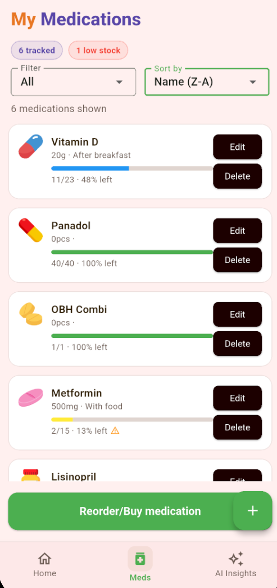<br/><sub><b>Sort: Name (Z-A)</b></sub></td>
  </tr>
</table>
</div>

| Query feature | How it is done |
|---|---|
| **Filters** | All, Low Stock, **Critical Stock (0-5)**, or by frequency (Once daily, Twice daily, Three times daily, Every 8 hours, As needed), all applied by Firestore with `.where()` |
| **Sorting** | Name (A-Z / Z-A) and Stock (low-high / high-low) with `.orderBy()` |
| **Same-field range filter** | Critical Stock combines `stockCount >= 0` **and** `stockCount <= 5`. Firestore needs the first `orderBy` on that same field, so this filter always sorts by stock |
| **Aggregation** | The "6 tracked / 1 low stock" chips come from Firestore `count()` queries (`medStatsProvider`), not from downloading and counting documents |
| **Stored `isLowStock`** | Firestore cannot compare `stockCount / totalCount` inside a query, so a computed `isLowStock` flag is saved on every write and filtered server-side |

Filter and sort choices live in Riverpod state (`medFilterProvider`, `medSortProvider`), and `medicationsProvider` rebuilds its Firestore query whenever they change.

## AI Insights

<div align="center">
<table>
  <tr>
    <td align="center" valign="top" width="260">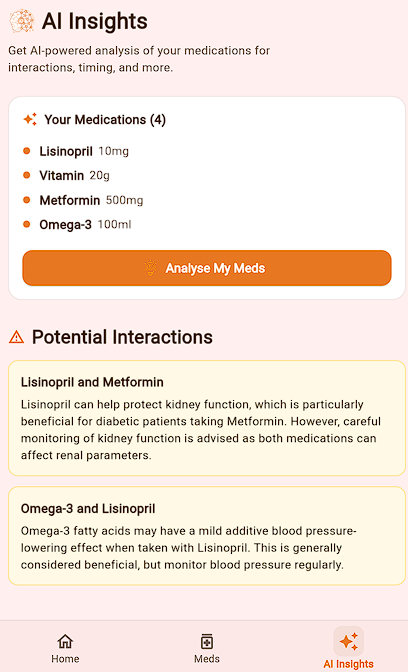</td>
    <td valign="top">
      <ul>
        <li>Tap <b>Analyse My Meds</b> and your <b>real medication list</b> (name, dose, frequency, instructions) is sent to <b>Groq</b> (<code>llama-3.1-8b-instant</code>).</li>
        <li>The prompt asks for <b>JSON only</b>, in a fixed shape, so the reply can be parsed straight into model objects.</li>
        <li>Results appear as <b>Potential Interactions</b> and <b>What Each Does</b> cards.</li>
        <li><b>Caching:</b> a signature of the medication list is compared with the last successful run. If nothing changed, the API is skipped and a SnackBar says so.</li>
        <li>The prompt tells the model to give general information only and never to advise changing a dose.</li>
        <li>Loading, empty and error states are all handled.</li>
      </ul>
    </td>
  </tr>
</table>
</div>

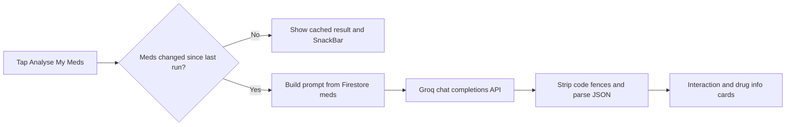

## Shop, cart and NETS QR checkout

<div align="center">
<table>
  <tr>
    <td align="center" valign="top">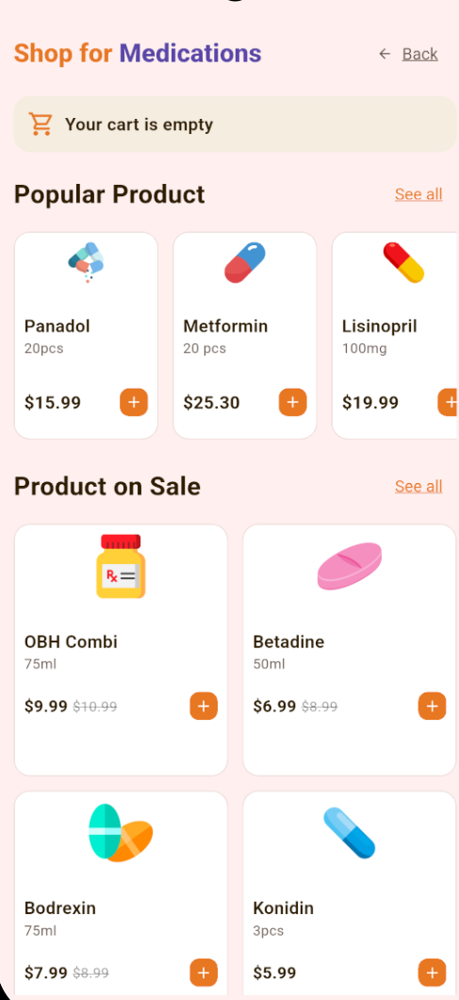<br/><sub><b>1. Browse the shop</b></sub></td>
    <td align="center" valign="top">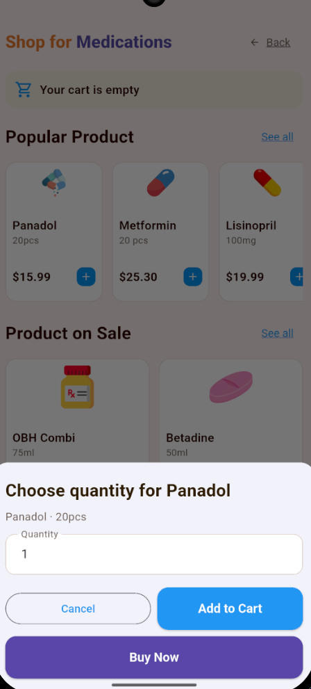<br/><sub><b>2. Choose quantity</b></sub></td>
    <td align="center" valign="top">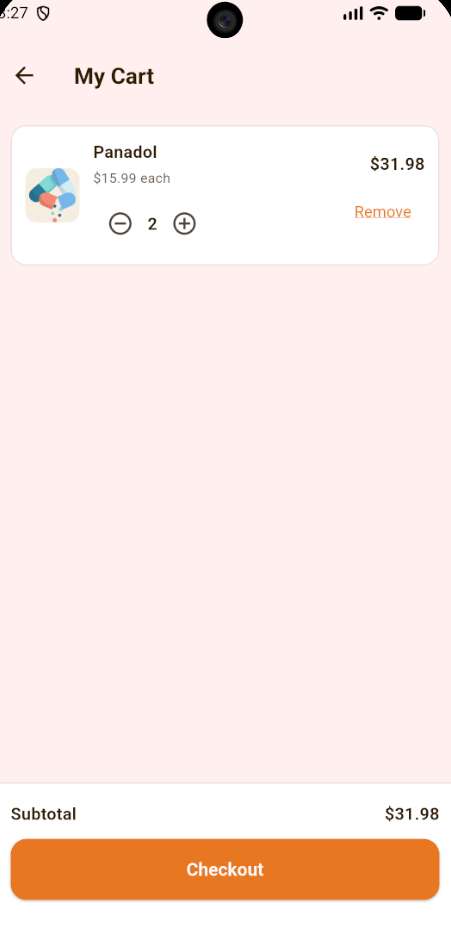<br/><sub><b>3. Review cart</b></sub></td>
  </tr>
  <tr>
    <td align="center" valign="top">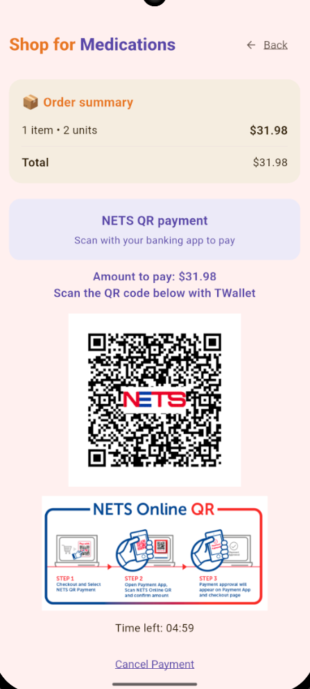<br/><sub><b>4. Scan the NETS QR</b></sub></td>
    <td align="center" valign="top">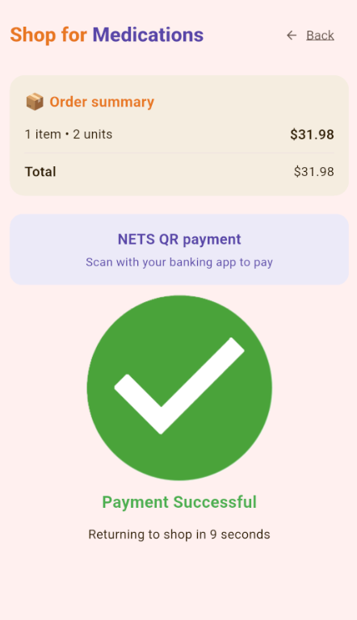<br/><sub><b>5. Payment successful</b></sub></td>
    <td align="center" valign="top"><br/><br/>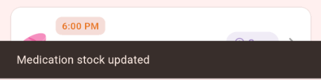<br/><sub><b>6. Stock updated automatically</b></sub></td>
  </tr>
</table>
</div>

**Cart**

- A quantity sheet offers **Add to Cart** or **Buy Now**, with validation (whole numbers from 1 to 999).
- The cart is saved to Firestore (`carts/{userEmail}`), so it survives navigation and app restarts. `ShopScreen` reloads it whenever you come back to it (`RouteAware.didPopNext`).
- **Pack-size aware:** `totalUnits = quantity x packSize`, so 2 packs of 20 adds 40 units to your stock.
- The cart screen supports quantity +/-, remove, and a live subtotal.

**NETS QR payment** (enhanced beyond the lab exercise)

- The QR is generated for the **real order total**, not a fixed amount.
- A 5-minute countdown runs while the QR is shown. A Server-Sent Events stream detects the scan, **reconnecting automatically** (up to 5 times) if the connection drops.
- Every NETS call has a **15-second timeout** so an unresponsive sandbox fails gracefully, and the QR request retries once when the sandbox rate-limits.
- Full state flow: `loading` → `idle` (QR shown) → `success` / `fail` → `complete`, with dedicated success and fail screens.
- **After payment:** if the medication already exists for the user its stock is increased, otherwise a new medication is created, and then the cart is cleared. The result shows up on the Meds tab straight away.

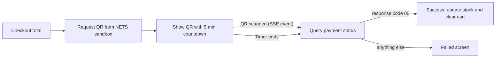

## Personalisation

<div align="center">
<table>
  <tr>
    <td align="center" valign="top"><br/><sub><b>Orange (default)</b></sub></td>
    <td align="center" valign="top">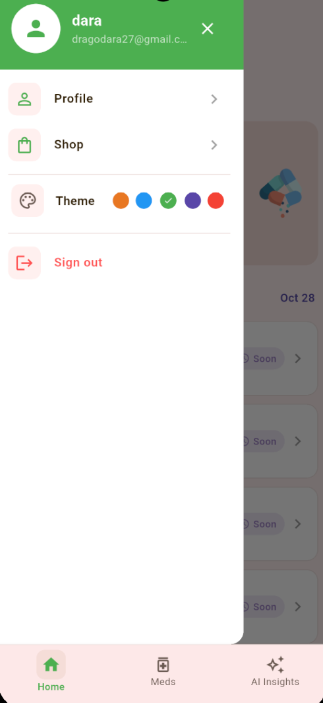<br/><sub><b>Green</b></sub></td>
    <td align="center" valign="top">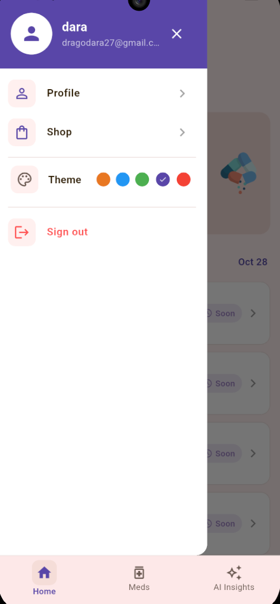<br/><sub><b>Purple</b></sub></td>
  </tr>
</table>

<table>
  <tr>
    <td align="center" valign="top"><br/><sub><b>App icon</b></sub></td>
    <td align="center" valign="top">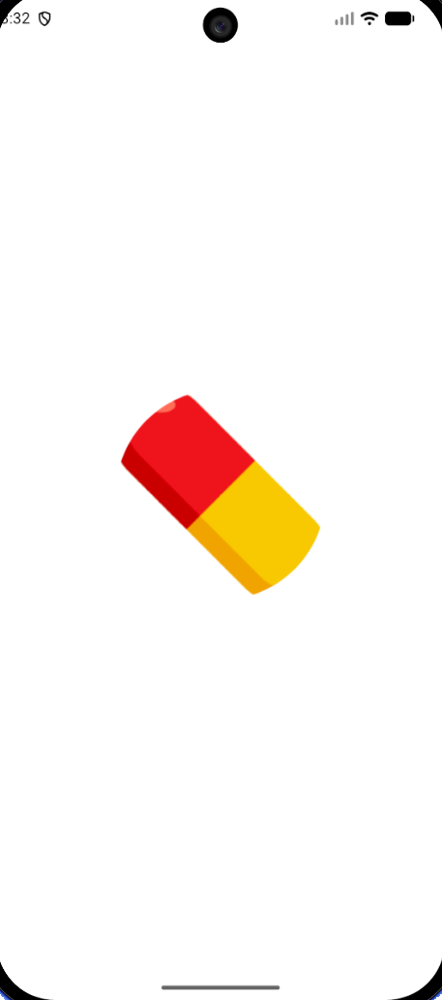<br/><sub><b>Splash screen</b></sub></td>
  </tr>
</table>
</div>

- **Theme picker** in the drawer: orange, blue, green, purple or red. The choice is saved with **SharedPreferences** and restored on the next launch.
- The picked colour seeds `ColorScheme.fromSeed` in `MaterialApp`, and screens read it through `Theme.of(context).colorScheme`, so buttons, icons, badges and the bottom navigation all follow. The two-tone MediBuddy wordmark stays fixed as brand identity.
- **Custom app icon** generated with `flutter_launcher_icons` and a **native splash screen** generated with `flutter_native_splash`.

## Form validation and feedback

<div align="center">
<table>
  <tr>
    <td align="center" valign="top">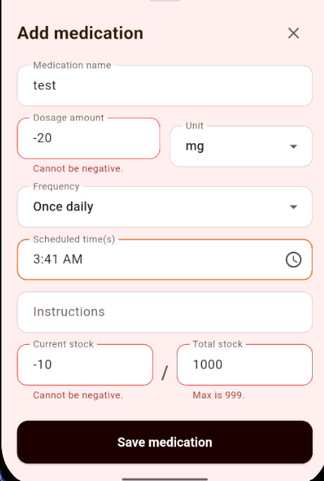<br/><sub><b>Add medication</b></sub></td>
    <td align="center" valign="top">
      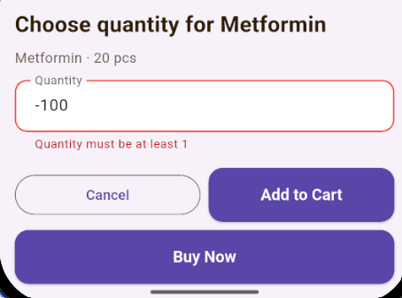<br/><sub><b>Shop quantity: minimum</b></sub><br/><br/>
      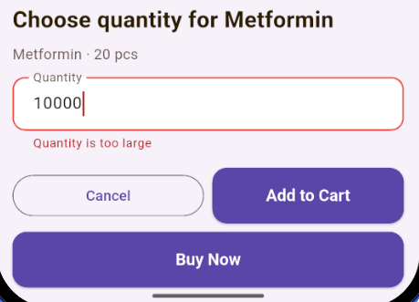<br/><sub><b>Shop quantity: maximum</b></sub><br/><br/>
      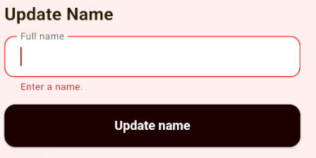<br/><sub><b>Update name</b></sub>
    </td>
  </tr>
</table>
</div>

- **Sign up:** name required, valid email, password of at least 6 characters, and password confirmation.
- **Medications:** dosage must be a non-negative number; current and total stock must be non-negative and at most 999.
- **Shop quantity:** required, whole number, between 1 and 999.
- **Feedback:** inline field errors for "fix this field", SnackBars for "here is what just happened", and confirmation dialogs before destructive actions such as deleting a medication.

## Architecture

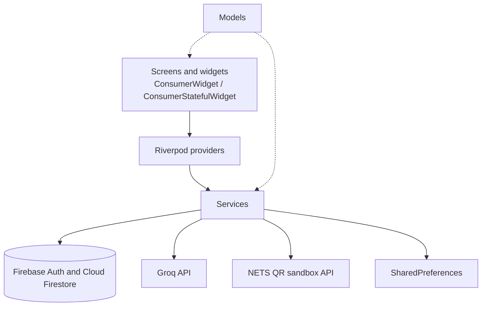

Screens never talk to Firebase or HTTP directly. They watch providers, and providers call services.

<details>
<summary><b>Project structure</b></summary>

```text
lib/
├── constants/
│   └── app_theme.dart            # colours, text styles, ThemeData builder
├── models/
│   ├── medication.dart           # Medication + Firestore mapping (stores isLowStock)
│   ├── cart_item.dart            # CartItem with packSize / totalUnits
│   ├── ai_insight.dart           # MedInteraction, DrugInfo
│   ├── med_ai_state.dart         # AI analysis state + cache signature
│   └── nets_state.dart           # NETS payment state
├── providers/
│   ├── firebase_provider.dart    # auth, medications, filter/sort, stats
│   ├── med_ai_provider.dart      # AI analysis controller + caching
│   ├── nets_provider.dart        # NETS payment controller
│   └── theme_provider.dart       # theme colour controller
├── services/
│   ├── firebase_service.dart     # all Auth + Firestore calls (CRUD, queries, cart)
│   ├── med_ai_service.dart       # Groq prompt, request, JSON parsing
│   ├── nets_service.dart         # NETS QR request / webhook (SSE) / query
│   └── theme_service.dart        # SharedPreferences wrapper
├── screens/                      # login, signup, reset password, main (tabs), home,
│                                 # medications, ai insights, shop, cart, checkout,
│                                 # profile, edit account
├── widgets/                      # app drawer, add-medication sheet, logo,
│                                 # NETS widget + success/fail widgets
├── firebase_options.dart
└── main.dart
```

</details>

<details>
<summary><b>Riverpod providers</b></summary>

| Provider | Type | Purpose |
|---|---|---|
| `firebaseServiceProvider` | `Provider` | Single shared `FirebaseService` |
| `authStateProvider` | `StreamProvider<User?>` | Drives login / logout routing |
| `medicationsProvider` | `StreamProvider<List<Medication>>` | Live, filtered and sorted medications |
| `medFilterProvider`, `medSortProvider` | `StateProvider<String>` | Current filter and sort choice |
| `medStatsProvider` | `FutureProvider.autoDispose` | Firestore `count()` stats |
| `medAiProvider` | `StateNotifierProvider` | AI analysis state, with caching |
| `netsProvider` | `StateNotifierProvider` | NETS payment lifecycle |
| `themeProvider` | `StateNotifierProvider<ThemeController, Color>` | Selected accent colour |
| `medAiServiceProvider`, `netsServiceProvider`, `themeServiceProvider` | `Provider` | Shared service instances |

</details>

<details>
<summary><b>Firestore data model</b></summary>

```text
medications/{autoId}
  name, dosage, unit, frequency, scheduledTime, instructions,
  stockCount, totalCount, userEmail, isLowStock

carts/{userEmail}
  userEmail, items[ name, quantity, pricePerUnit, image, packSize ]
```

</details>

### Tech stack

| Purpose | Technology |
|---|---|
| Framework | Flutter and Dart (SDK `^3.11.5`) |
| Auth | `firebase_auth` ^6.3.0, `google_sign_in` ^6.2.1 |
| Database | `cloud_firestore` ^6.2.0, `firebase_core` ^4.6.0 |
| State management | `flutter_riverpod` ^3.3.1 |
| AI | Groq chat completions API (`llama-3.1-8b-instant`) via `http` ^1.6.0 |
| Payments | NETS QR sandbox API (REST and Server-Sent Events) |
| Local storage | `shared_preferences` ^2.5.5 |
| App identity | `flutter_launcher_icons`, `flutter_native_splash` |
| Formatting | `intl` ^0.20.2 |

## Getting started

### Prerequisites

- Flutter SDK with Dart 3.11.5 or newer
- Android Studio or VS Code with the Flutter extension
- An Android emulator (or Chrome for the web build)
- A Firebase project

### 1. Clone and install

```bash
git clone <your-repo-url>
cd medibuddy
flutter pub get
```

### 2. Set up Firebase

1. Create a Firebase project.
2. Enable **Authentication** providers: Email/Password, Google, and GitHub (GitHub needs an OAuth app that uses the callback URL Firebase gives you).
3. Create a **Cloud Firestore** database.
4. Connect the app to your project:

   ```bash
   dart pub global activate flutterfire_cli
   firebase login
   flutterfire configure
   ```

   This generates `lib/firebase_options.dart` and `android/app/google-services.json`.
5. For Google Sign-In on Android, add your debug **SHA-1** fingerprint (`./gradlew signingReport`) in the Firebase console, and put your own web client ID in `signInWithGoogle()` in `lib/services/firebase_service.dart`.

### 3. Add your API keys

| Feature | Where | What |
|---|---|---|
| AI Insights | `lib/services/med_ai_service.dart` (`groqKey`) | A free key from [console.groq.com](https://console.groq.com/) |
| NETS QR | `lib/services/nets_service.dart` (`apiKey`, `projectId`) | NETS sandbox credentials |

### 4. Firestore indexes

Combining a `.where()` filter with an `.orderBy()` on a different field needs a **composite index**. The first time you try a new filter and sort combination, Firestore logs an error containing a link. Open it, click **Create index**, wait about a minute, then try again. You only need to do this once per combination.

### 5. Run

```bash
flutter run
```

> [!TIP]
> When testing **NETS QR**, run **without the debugger** (VS Code: *Run > Start Without Debugging*). Debug mode can interrupt the SSE stream that detects the scan. Pay with the **NETS Payment Simulator (TWallet)** app, and note that the sandbox allows only a few QR requests per second.

### 6. Regenerate icon and splash (optional)

```bash
dart run flutter_launcher_icons
dart run flutter_native_splash:create
```

### 7. Tests

```bash
flutter test
```

Includes a unit test for the cart pack-size maths (`totalUnits = quantity x packSize`).

## Notes and limitations

- **GitHub sign-in** uses Firebase's popup flow (`signInWithPopup`), which targets **Flutter web**.
- **Payments are sandbox only.** No real transactions take place.
- **AI output is informational.** Always check with a pharmacist or doctor before changing how you take any medication.
- Keep API keys out of public repositories. Use your own keys and rotate any that have been shared.

## Author

**Tao Yi Yu Dara**<br/>
Temasek Polytechnic, School of Informatics & IT. MBAP Project, Part 3.

### Acknowledgements

- [Groq](https://console.groq.com/docs) for LLM inference
- NETS QR sandbox API, provided through the course
- [FlutterFire](https://firebase.google.com/docs/flutter/setup), [Riverpod](https://pub.dev/packages/flutter_riverpod), and the Flutter community packages used in this project
